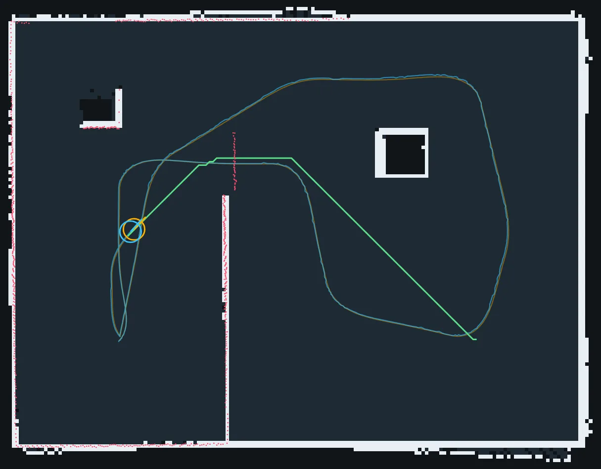
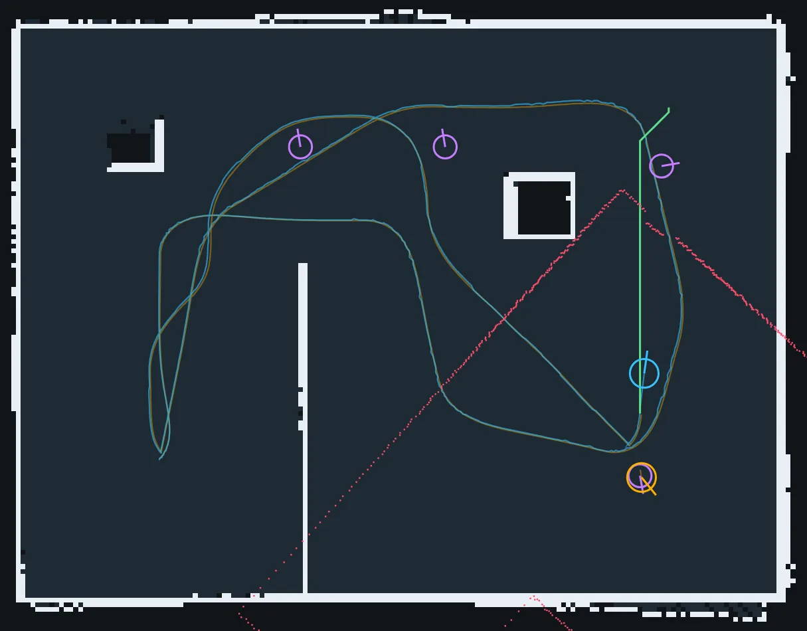

# Robolet

**마이크로컨트롤러 하나에 들어가는 ROS 2 방식 로봇 OS**

[](https://doi.org/10.5281/zenodo.24574818)

Robolet은 ESP32-S3 칩 하나에서 2D 라이다 주행 소프트웨어 전체를 실행합니다. 포함된 기능은 다음과 같습니다.

- 지도 작성 (SLAM, simultaneous localization and mapping)
- 위치 추정 (AMCL 방식 파티클 필터)
- kidnap(로봇이 모르게 다른 곳으로 옮겨짐) 감지와 위치 재인식
- 경로 계획, 경로 추적
- collision monitor(장애물 앞 감속·정지), 복구 동작

칩 안의 소프트웨어는 ROS 2와 Nav2의 구조를 따릅니다. 노드(node), 토픽(topic), 서비스(service), 파라미터(parameter), 라이프사이클(lifecycle) 노드와 라이프사이클 관리자, 그리고 `navigate_to_pose`와 `navigate_through_poses` 액션(action)이 있습니다. 메시지는 CDR(common data representation)로 직렬화(serialization)되며, 확인한 86종에서 바이트 단위로 ROS 2와 같습니다. PC는 필수가 아닙니다. PC를 연결하면 로봇 상태를 보고, `ros2` 명령과 같은 형식으로 명령을 보내고, 칩의 토픽을 ROS 2 네트워크로 내보내 rviz2로 볼 수 있습니다.

[English README](README.md)

<p align="center">
  
  
</p>
<p align="center"><sub>왼쪽: 로봇이 작성한 지도 위에서 주행. 파랑은 추정 위치, 주황은 실제 위치, 초록은 계획 경로, 빨강은 라이다 점입니다. 오른쪽: 로봇을 다른 곳으로 옮긴 뒤, 로봇이 위치 후보 4개(보라)를 찾고 제자리 회전으로 하나만 남기는 과정입니다. 화면은 <code>tools/viewer.py</code>이고, 시뮬레이션 방에서 칩 코드를 PC로 빌드해 실행했습니다.</sub></p>

## 현재 상태

| 항목 | 상태 |
|---|---|
| ESP32-S3-N16R8에서 전체 스택 실행 (로봇과 라이다는 칩 안에서 시뮬레이션) | ✅ 칩에서 측정 ([결과](docs/results.md)) |
| Gazebo Harmonic 속 로봇을 칩이 주행 (HILS, hardware-in-the-loop simulation) | ✅ 칩에서 측정 |
| ROS 2 인터페이스 (토픽, 서비스, 파라미터, 라이프사이클, 액션), CDR 바이트 일치 | ✅ 칩에서 확인, `rosbags`와 대조 |
| `ros2` 방식 PC 명령 도구 (`tools/ros2.py`) | ✅ 칩에서 확인 |
| PC의 ROS 2 네트워크: rviz2, `ros2 topic`, 키보드 조종 | ✅ `tools/ros2_bridge.py`(ROS 2 Humble)가 칩의 토픽을 바꾸지 않고 발행. rviz2에서 지도, 계획 경로, 위치 표시 확인. 서비스와 액션은 `tools/ros2.py` |
| 실제 로봇: YDLIDAR X4 / X4 Pro, 자라봇 차체(아두이노 모터 제어기) | 🔄 실제 로봇 모드(`r`): 키보드로 지도 작성 후 목표 주행. 모의 자라봇으로 PC 시험 통과. 실물 시험 전 ([docs/jarabot.md](docs/jarabot.md), 영어) |
| 칩 안의 ROS 2 미들웨어 (DDS / Zenoh), PC 없이 | ⏳ 계획 |

Robolet은 연구용 시제품(버전 0.16)입니다. 인터페이스는 바뀔 수 있습니다.

## 칩에서 실행되는 노드

| 노드 | 하는 일 | ROS 2 / Nav2의 대응 패키지 |
|---|---|---|
| `x4_driver` | YDLIDAR X4 바이트 → `/scan`, `/scan_cloud` (주행 중 생긴 스캔 왜곡을 점마다 보정) | 라이다 드라이버 |
| `slam` | 스캔 매칭으로 점유 격자 지도(칸 5 cm) 작성 → `/map`, `/pose` | slam_toolbox |
| `amcl` | 지도 위 파티클 필터 → `/amcl_pose` | nav2_amcl |
| `localization_monitor` | 라이다 빔으로 추정 위치를 점검. kidnap이면 광역 위치 추정, 위치 후보 작성, 후보가 하나 남을 때까지 제자리 회전, 또는 안전 정지 | (Nav2에 없음) |
| `planner_server` | costmap 위 A* → `/plan` | nav2_planner |
| `controller_server` | 경로 추적 → `/cmd_vel_nav` | nav2_controller |
| `behavior_server` | 복구 동작을 차례로 실행(costmap의 장애물 층 지우기, 제자리 회전, 후진, 대기). 4번 실패하면 목표를 중단 | nav2_behaviors |
| `collision_monitor` | 장애물 앞에서 감속·정지 → `/cmd_vel` | nav2_collision_monitor |
| `goal_checker` | 목표 도달 판정 | Nav2 goal checker |
| `bt_navigator` | `navigate_to_pose`, `navigate_through_poses` 액션 서버 | nav2_bt_navigator |
| `lifecycle_manager_navigation` | 위 노드들을 설정·활성화. `manage_nodes`, `is_active` 서비스 | nav2_lifecycle_manager |

모든 노드는 `rcl_interfaces` 파라미터 서비스(get, set, set atomically, list, describe, get types)를 제공하고 `/parameter_events`를 발행합니다. 라이프사이클 노드는 `change_state`, `get_state`, `get_available_transitions`를 제공하고 `~/transition_event`를 발행합니다. 로그는 `/rosout`, 시뮬레이션 시간은 `/clock`으로 발행합니다. 자세한 내용: [docs/architecture.md](docs/architecture.md) (영어).

## 측정값 (ESP32-S3-N16R8, 240 MHz, 코어 1개)

| 항목 | 값 |
|---|---|
| 로봇 쪽 노드의 코어 1개 사용률 | 지도 작성 중 28.9–29.6 %, 주행 중 13.9–19.7 % (환경 5개) |
| 가장 긴 주기 (한도: 라이다 1회전, 143 ms) | 124–136 ms (환경 5개, kidnap 뒤 위치 재인식 포함) |
| kidnap 감지까지 걸린 시간 | 0.29 s |
| 위치 재인식 오차 | 0.01–0.04 m |
| 작성한 지도의 벽과 실제 벽의 평균 거리 | 1.5–2.8 cm |
| 컴파일 때 정해지는 RAM / 플래시 사용률 | 25.0 % / 8.1 % (펌웨어 0.15, PlatformIO 빌드) |
| 임무 5회 연속 실행 뒤 메모리 | 실행 전과 같음 |

각 수치의 출처와 조건은 [docs/results.md](docs/results.md)에 있습니다.

## 시작하기

**하드웨어:** ESP32-S3 보드(플래시 16 MB, PSRAM 8 MB, ESP32-S3-N16R8)와 USB 케이블이 필요합니다. YDLIDAR X4와 모터 차체는 없어도 됩니다. 없으면 칩이 로봇과 라이다를 시뮬레이션합니다. 배선: [docs/hardware.md](docs/hardware.md).

**소프트웨어:** PlatformIO, Python 3과 `pyserial`이 필요합니다. `numpy`는 선택입니다.

```bash
git clone https://github.com/robolet-os/robolet.git
cd robolet/firmware
bash test.sh            # 빌드, 업로드, 보드 확인, 연산 벤치마크, 가상 라이다, 가상 주행
bash test.sh shell      # 방 임무를 실시간으로 실행하고 ros2 방식 프롬프트를 엶
```

프롬프트에서 쓰는 명령 예:

```
robolet> node list
robolet> topic echo /rosout
robolet> param set /controller_server max_vel_x 0.25
robolet> action send_goal /navigate_to_pose "{pose: {pose: {position: {x: 6.5, y: 1.5}}}}" --feedback
robolet> mission stop
```

프롬프트가 열려 있는 동안 다른 터미널에서도 같은 명령을 쓸 수 있습니다. 예: `python3 tools/ros2.py topic hz /scan`.

다른 `test.sh` 옵션(kidnap 임무, 브라우저 뷰어, Gazebo, ROS 2 점검)은 [docs/testing.md](docs/testing.md)에 있습니다.

### rviz2 (PC의 ROS 2 Humble)

```bash
python3 tools/ros2.py daemon --chip "k 0 1 0 3 rt hold"                 # 방 임무 후 목표를 기다림
source /opt/ros/humble/setup.bash
/usr/bin/python3 tools/ros2_bridge.py                                   # 칩의 토픽을 ROS 2로 (시스템 Python)
rviz2 -d tools/robolet.rviz --ros-args -p use_sim_time:=true            # "2D Goal Pose"가 navigate_to_pose 목표를 보냄
```

## 보드 없이 PC에서 시험

```bash
cd firmware
bash test_host/run_pc_tests.sh          # 약 5분
bash test_host/run_pc_tests.sh full     # 약 30분
```

같은 C++ 헤더를 PC와 칩에서 빌드합니다. PC 시험에서 확인하는 항목은 다음과 같습니다.
- 노드로 나눈 스택의 결과가, 노드로 나누기 전 함수 하나에서 모든 처리를 하던 이전 구현과 같은지 (임무 240가지)
- 메시지·서비스·액션 86종의 CDR 바이트가 `rosbags`와 같은지
- 서비스, 액션, 명령 도구가, 칩의 직렬 통신 동작을 PC에서 재현하는 시험 프로그램(`test_host/test_gz.cpp`)에서 동작하는지

## 저장소 구성

```
firmware/
  src/          펌웨어 (헤더만 있는 C++17. 같은 코드를 PC에서도 빌드)
  msg/          사용하는 ROS 2 인터페이스 정의(.msg/.srv/.action)와 고정 크기
  tools/        PC 도구: ros2.py(명령 도구), viewer.py(브라우저 뷰어), gzbridge.py(Gazebo),
                robolet.py(직렬 통신 라이브러리), check_*.py(점검), gen_msgs.py(msg → C++)
  test_host/    PC 빌드와 시험
  gazebo/       Gazebo 환경과 메모
  test.sh       빌드 + 업로드 + 칩 시험
docs/           구조, 시험, 결과, 하드웨어, 그림 (영어)
results/chip/   칩 실행 기록
```

## 한계

- 지도 크기가 고정되어 있습니다(10 × 8 m, 칸 5 cm). 지도는 실행마다 새로 만들며, 지도 저장과 루프 클로징(loop closure)은 아직 없습니다.
- 로봇 형태는 한 가지입니다. 차동 구동이고 로봇 모양이 원형(반지름 0.18 m)인 경우만 지원합니다.
- 칩 안의 시뮬레이션 라이다는 환경 5개 중 4개에서 격자에 맞춘 벽을 봅니다. 이 조건은 스캔 매칭에 유리합니다. Gazebo에서는 지도 벽 평균 오차가 5.5–7.7 cm로 더 큽니다.
- Nav2 같은 플러그인 구조가 없습니다. 알고리즘은 코드에 고정되어 있습니다.
- 칩 안에는 ROS 2 미들웨어가 없습니다. PC의 브리지(`tools/ros2_bridge.py`)가 칩의 토픽을 ROS 2로 내보냅니다. 서비스와 액션은 `tools/ros2.py`로 다룹니다.

## 라이선스와 고지

Apache License 2.0을 따릅니다. [LICENSE](LICENSE)와 [NOTICE](NOTICE)를 보십시오. `firmware/msg/`의 인터페이스 정의는 이름이 같은 ROS 2 패키지의 정의를 따르며, 해당 패키지는 Apache License 2.0을 따릅니다.

Robolet은 독립 프로젝트입니다. Open Robotics(ROS, ROS 2), Nav2 프로젝트, Espressif Systems(ESP32)와 관계가 없고, 이들의 보증을 받지 않았습니다.

## 인용

[CITATION.cff](CITATION.cff)를 보십시오. DOI(digital object identifier)는 모든 버전 [10.5281/zenodo.24574818](https://doi.org/10.5281/zenodo.24574818), 버전 0.16.0 [10.5281/zenodo.24574819](https://doi.org/10.5281/zenodo.24574819)입니다(Zenodo).

## 용어

| 용어 | 영어 | 뜻 | 출처 |
|---|---|---|---|
| 노드 | node | 한 가지 일을 맡은 실행 단위 | ROS 2 문서 |
| 토픽 | topic | 노드 사이에 메시지를 주고받는 이름 있는 통로 | ROS 2 문서 |
| 서비스 | service | 요청 하나에 응답 하나를 돌려주는 통신 | ROS 2 문서 |
| 액션 | action | 목표, 중간 피드백, 결과, 취소가 있는 긴 작업 통신 | ROS 2 문서 |
| 파라미터 | parameter | 노드의 설정값. 실행 중 바꿀 수 있음 | ROS 2 문서 |
| 라이프사이클 | lifecycle | 노드의 상태(unconfigured, inactive, active, finalized)와 전환 | ROS 2 문서 |
| 라이프사이클 관리자 | lifecycle manager | 여러 라이프사이클 노드를 정해진 순서로 설정하고 활성화하는 노드 | Nav2 문서 (nav2_lifecycle_manager) |
| 직렬화 | serialization | 메시지를 전송용 바이트열로 바꾸는 것 | OMG DDS-XTypes 1.3 |
| CDR | common data representation | ROS 2(DDS)가 메시지를 바이트로 바꾸는 형식 | OMG DDS-XTypes 1.3 (Extended CDR 인코딩) |
| SLAM | simultaneous localization and mapping | 이동하며 지도를 만들고 동시에 그 지도에서 위치를 추정하는 방법 | Thrun, Burgard, Fox, *Probabilistic Robotics*, MIT Press, 2005 |
| 발행 | publish | 노드가 토픽에 메시지를 보내는 것 | ROS 2 문서 |
| DOI | digital object identifier | 자료에 붙는 영구 식별자. 주소가 바뀌어도 같은 자료를 가리킴 | DOI Foundation (doi.org) |
| 브리지 | bridge | 칩의 토픽을 PC의 ROS 2 네트워크로 넘기고, rviz2의 목표를 칩으로 보내는 PC 프로그램(`tools/ros2_bridge.py`) | 이 저장소의 정의 |
| 점유 격자 지도 | occupancy grid map | 공간을 칸으로 나누고 칸마다 비었는지 차 있는지를 적은 지도 | Thrun 외, 2005; 대한기계학회 학술대회 2001 "스테레오 비전 방식을 이용한 자율 이동로봇의 격자지도 작성" (키워드 "점유격자 지도") |
| costmap | costmap | 점유 격자 지도에 장애물까지의 거리에 따른 비용을 더한 지도. 국내 자료도 영어를 그대로 씀 | Nav2 문서 (nav2_costmap_2d); tilnote "ROS2" 특강의 Nav2 장 |
| 파티클 필터 | particle filter | 많은 표본(파티클)으로 확률 분포를 나타내 위치를 추정하는 방법 | Thrun 외, 2005 |
| AMCL | adaptive Monte Carlo localization | 파티클 필터로 지도 위 위치를 추정하고, 파티클 수를 상황에 따라 바꾸는 방법 | Nav2 문서 (nav2_amcl), Thrun 외, 2005 |
| kidnap | kidnapped robot problem | 로봇이 모르게 다른 위치로 옮겨지는 상황. 이를 감지하고 위치를 다시 구하는 문제를 kidnapped robot problem이라 함. 국내 논문도 영어를 그대로 씀 | Thrun 외, 2005; 로봇학회논문지 2007 "표식 지도를 이용한 이동로봇의 광역 위치인식 및 kidnap recovery" |
| 광역 위치 추정 | global localization | 처음 위치를 모르는 상태에서 지도 전체를 대상으로 위치를 구하는 것 | Thrun 외, 2005; POSTECH 학위논문 "…광역 위치추정 및 Kidnap recovery 전략" |
| 위치 재인식 | relocalization | 위치 추정이 틀렸음을 감지한 뒤 광역 위치 추정으로 위치를 다시 구하는 것 | 로봇학회논문지 14(2), 2019 "…6자유도 위치 재인식" |
| 스캔 매칭 | scan matching | 라이다 스캔을 지도나 다른 스캔에 맞춰 위치를 구하는 방법 | Lu, Milios, J. Intelligent and Robotic Systems 18, 1997; KoreaScience JAKO201610953524743 "LRF 기반의 스캔매칭을 위한…" |
| 루프 클로징 | loop closure | 이미 지나간 곳에 돌아왔음을 인식해 지도 오차를 줄이는 방법 | Thrun 외, 2005; KoreaScience JAKO202319440315196 "UWB 기반 실내 측위 기술을 활용한 루프 클로징 기법" |
| 경로 계획 | path planning | 지도 위에서 목표까지 갈 경로를 구하는 것 | Siegwart, Nourbakhsh, Scaramuzza, *Introduction to Autonomous Mobile Robots*, 2nd ed., MIT Press, 2011 |
| 경로 추적 | path following | 계획한 경로를 따라가도록 속도 명령을 내는 것 | Nav2 문서 (nav2_controller); 전기학회논문지P 2002 "…차동 구륜이동로봇의 동역학 모델링과 경로추적" |
| collision monitor | collision monitor | 장애물 가까이에서 속도를 줄이거나 멈추는 기능. 통용 한국어를 찾지 못해 영어를 씀 | Nav2 문서 (nav2_collision_monitor) |
| 복구 동작 | recovery behavior | 주행이 막혔을 때 회전, 후진, 대기 등으로 다시 시도하는 동작 | Nav2 문서 (nav2_behaviors); tilnote "ROS2" 특강의 Nav2 장 |
| 주기 | cycle | 라이다 1회전분 스캔을 받아 모든 노드를 한 번 실행하는 단위 | 이 저장소의 정의 |
| HILS | hardware-in-the-loop simulation | 실제 제어기(칩)를 시뮬레이션된 로봇과 연결해 시험하는 방법. 국내 논문은 약어를 그대로 씀 | KoreaScience JAKO202419357608307 "생체모방로봇 소프트웨어 검증 지원 다중 HILS 기반 로봇 테스트베드…" |
| 차동 구동 | differential drive | 좌우 바퀴 속도 차이로 방향을 바꾸는 구동 방식 | Siegwart 외, 2011; 전기학회논문지P 2002 ("차동 구륜이동로봇") |
| PSRAM | pseudo-static RAM | ESP32-S3 모듈에 붙은 외부 메모리 | Espressif ESP32-S3 데이터시트 |

한국어 용어는 국내 논문(로봇학회논문지, KoreaScience)에서 쓰는 말을 따랐고, 통용 한국어가 없으면 영어를 그대로 썼습니다(2026-11-27 웹 검색 범위). TTA 정보통신용어사전과는 대조하지 않았습니다. 더 널리 쓰는 말이 있으면 이슈로 알려 주십시오.
