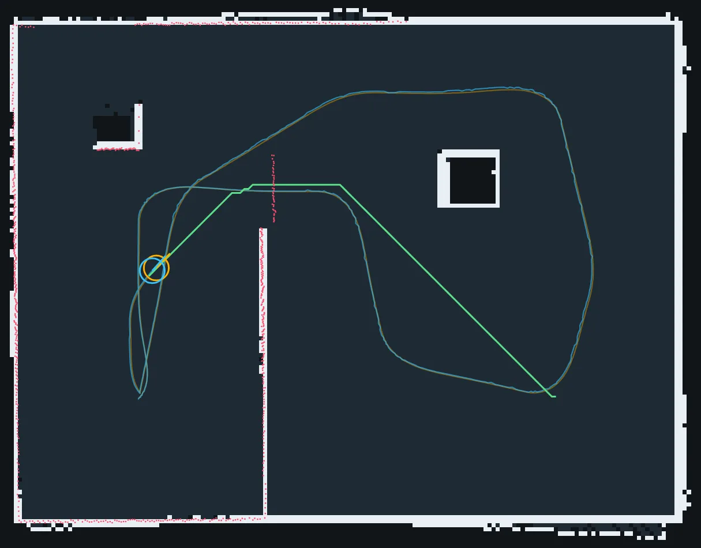
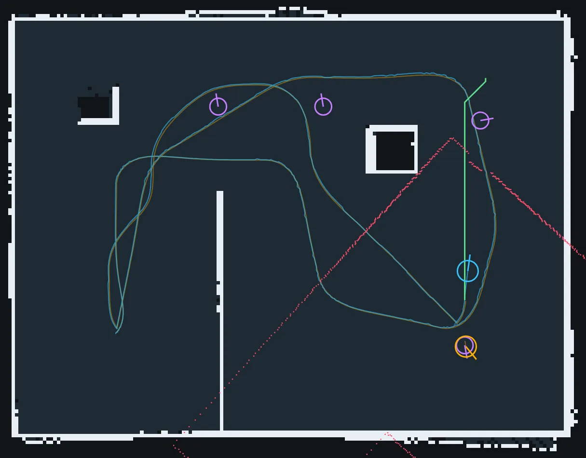

# Robolet

**A ROS 2–style robot OS that fits on a single microcontroller.**

[](https://doi.org/10.5281/zenodo.24574818)

Robolet runs a complete 2D-lidar navigation stack on one ESP32-S3: mapping (SLAM), localization (AMCL-style particle filter), detection of and recovery from a kidnapped robot, path planning, path following, collision monitoring and recovery behaviors. On the chip, the software is organized like ROS 2 and Nav2: nodes, topics, services, parameters, lifecycle nodes with a lifecycle manager, and the `navigate_to_pose` / `navigate_through_poses` actions. Messages are serialized in CDR, byte for byte the same as ROS 2 for the 86 types checked. A PC is optional: it can watch the robot, send commands with a `ros2`-style command line, and publish the chip's topics on a ROS 2 network for rviz2.

[한국어 README](README.ko.md)

<p align="center">
  
  
</p>
<p align="center"><sub>Left: navigating on the map the robot built (blue = estimated pose, orange = true pose, green = planned path, red = lidar points). Right: after being carried to another place, the robot finds four candidate poses (violet) and turns in place until one is left. Screens of <code>tools/viewer.py</code>, simulated room, PC build of the chip code.</sub></p>

## Status

| | |
|---|---|
| Whole stack on an ESP32-S3-N16R8, simulated robot and lidar on the chip | ✅ measured on the chip ([results](docs/results.md)) |
| Chip drives a robot simulated in Gazebo Harmonic (hardware in the loop) | ✅ measured on the chip |
| ROS 2 interfaces: topics, services, parameters, lifecycle, actions; CDR = ROS 2 | ✅ checked on the chip and against `rosbags` |
| `ros2`-style PC command line (`tools/ros2.py`) | ✅ checked on the chip |
| ROS 2 network on the PC: rviz2, `ros2 topic`, keyboard teleop | ✅ `tools/ros2_bridge.py` (ROS 2 Humble) publishes the chip's topics unchanged; rviz2 showed the map, the plan and the poses. Services and actions: `tools/ros2.py` |
| Real robot: YDLIDAR X4 / X4 Pro, Jarabot base (Arduino motor controller) | 🔄 real-robot mode (`r`): keyboard mapping, then goals; PC test with a simulated Jarabot passes; not yet tested on the robot ([docs/jarabot.md](docs/jarabot.md)) |
| ROS 2 middleware on the chip (DDS / Zenoh), no PC | ⏳ planned |

Robolet is a research prototype (version 0.16). Interfaces may change.

## What runs on the chip

| Node | Does | ROS 2 / Nav2 counterpart |
|---|---|---|
| `x4_driver` | YDLIDAR X4 bytes → `/scan`, `/scan_cloud` (with motion de-skew) | lidar driver |
| `slam` | occupancy grid (5 cm cells) by scan matching → `/map`, `/pose` | slam_toolbox |
| `amcl` | particle filter on the map → `/amcl_pose` | nav2_amcl |
| `localization_monitor` | beam check of the pose; on a kidnapping: global search, candidates, turning in place until one is left, or a safe stop | (none in Nav2) |
| `planner_server` | A* on the costmap → `/plan` | nav2_planner |
| `controller_server` | path following → `/cmd_vel_nav` | nav2_controller |
| `behavior_server` | recoveries in turn (clear the obstacle layer, spin, back up, wait); aborts a goal after 4 failures | nav2_behaviors |
| `collision_monitor` | slows down / stops before obstacles → `/cmd_vel` | nav2_collision_monitor |
| `goal_checker` | goal reached | nav2 goal checker |
| `bt_navigator` | `navigate_to_pose`, `navigate_through_poses` action servers | nav2_bt_navigator |
| `lifecycle_manager_navigation` | configures and activates the nodes above, `manage_nodes`, `is_active` | nav2_lifecycle_manager |

Every node serves the `rcl_interfaces` parameter services (get, set, set atomically, list, describe, get types) and publishes `/parameter_events`; managed nodes serve `change_state`, `get_state`, `get_available_transitions` and publish `~/transition_event`. Logs go to `/rosout`; the simulated time to `/clock`. Details: [docs/architecture.md](docs/architecture.md).

## Measurements (ESP32-S3-N16R8, 240 MHz, one core)

| | |
|---|---|
| Robot nodes, share of one core | 28.9–29.6 % while mapping, 13.9–19.7 % while navigating (5 worlds) |
| Longest cycle (limit: one lidar revolution, 143 ms) | 124–136 ms (5 worlds, including relocalization after a kidnapping) |
| Kidnapping detected after | 0.29 s |
| Relocalization error | 0.01–0.04 m |
| Map walls vs. true walls (mean distance) | 1.5–2.8 cm |
| Static RAM / flash | 25.0 % / 8.1 % (firmware 0.15, PlatformIO build) |
| Memory after five missions in a row | same as before (no leak) |

Sources and conditions for every number: [docs/results.md](docs/results.md).

## Quick start

**Hardware:** an ESP32-S3 board with 16 MB flash and 8 MB PSRAM (ESP32-S3-N16R8), USB cable. The YDLIDAR X4 and a motor base are optional; without them the chip simulates the robot and the lidar. Wiring: [docs/hardware.md](docs/hardware.md).

**Software:** PlatformIO, Python 3 with `pyserial` (and `numpy`, optional).

```bash
git clone https://github.com/robolet-os/robolet.git
cd robolet/firmware
bash test.sh            # build, upload, board check, compute benchmark, virtual lidar, virtual driving
bash test.sh shell      # a room mission in real time and a ros2-style prompt
```

In the shell:

```
robolet> node list
robolet> topic echo /rosout
robolet> param set /controller_server max_vel_x 0.25
robolet> action send_goal /navigate_to_pose "{pose: {pose: {position: {x: 6.5, y: 1.5}}}}" --feedback
robolet> mission stop
```

Other terminals can use the same commands while the shell runs: `python3 tools/ros2.py topic hz /scan`.

More `test.sh` options (missions with kidnapping, the browser viewer, Gazebo, ROS 2 checks): [docs/testing.md](docs/testing.md).

### rviz2 (ROS 2 Humble on the PC)

```bash
python3 tools/ros2.py daemon --chip "k 0 1 0 3 rt hold"                 # a room mission that then waits for goals
source /opt/ros/humble/setup.bash
/usr/bin/python3 tools/ros2_bridge.py                                   # the chip's topics on ROS 2 (system Python)
rviz2 -d tools/robolet.rviz --ros-args -p use_sim_time:=true            # "2D Goal Pose" sends a navigate_to_pose goal
```

## Tests without a board

```bash
cd firmware
bash test_host/run_pc_tests.sh          # about 5 minutes
bash test_host/run_pc_tests.sh full     # about 30 minutes
```

The same C++ headers build for the PC and the chip. The PC tests check that the node version of the stack gives exactly the same results as an earlier single-loop version (240 mission cases), that the CDR bytes match `rosbags` for all 86 message, service and action types, and the services, actions and the command line against a PC program that reproduces the chip's serial interface (`test_host/test_gz.cpp`).

## Repository layout

```
firmware/
  src/          the firmware (header-only C++17; the same code builds on the PC)
  msg/          ROS 2 interface definitions used (.msg/.srv/.action) and fixed capacities
  tools/        PC tools: ros2.py (command line), viewer.py (browser viewer), gzbridge.py (Gazebo),
                robolet.py (link library), check_*.py (checks), gen_msgs.py (msg -> C++)
  test_host/    PC builds and tests
  gazebo/       Gazebo worlds and notes
  test.sh       build + upload + chip tests
docs/           architecture, testing, results, hardware, images
results/chip/   logs of the chip runs
```

## Limitations

- The map has a fixed size (10 × 8 m at 5 cm per cell) and is built once per run; no map saving, no loop closure yet.
- One robot type: differential drive, round footprint (radius 0.18 m).
- The simulated lidar of the chip sees grid-aligned walls in four of the five worlds, which favors scan matching; in Gazebo the mean map error is larger (5.5–7.7 cm).
- No plugin system like Nav2: the algorithms are fixed in the code.
- No ROS 2 middleware on the chip: a bridge on the PC (`tools/ros2_bridge.py`) puts the chip's topics on ROS 2; services and actions go through `tools/ros2.py`.

## License and notices

Apache License 2.0, see [LICENSE](LICENSE) and [NOTICE](NOTICE). The interface definitions in `firmware/msg/` follow the ROS 2 packages they name (Apache License 2.0).

Robolet is an independent project. It is not affiliated with or endorsed by Open Robotics (ROS, ROS 2), the Nav2 project, or Espressif Systems (ESP32).

## Citing

See [CITATION.cff](CITATION.cff). DOI for all versions: [10.5281/zenodo.24574818](https://doi.org/10.5281/zenodo.24574818); version 0.16.0: [10.5281/zenodo.24574819](https://doi.org/10.5281/zenodo.24574819) (Zenodo).
